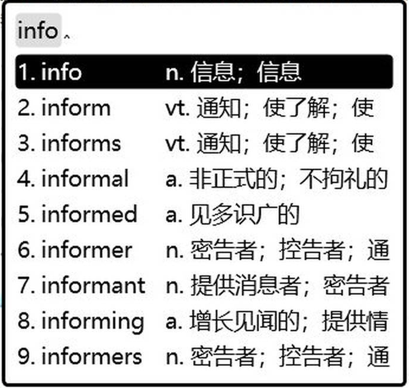

# rime-en2zh —— 英文输入 + 中文释义 + 大模型实时翻译

给 [Rime](https://rime.im/) 的一套双语方案。**在中文输入里顺手查英文词**：

* **英文模式**：中文方案里单击 <kbd>Shift</kbd> → 切到英文模式，打字即出候选 —— 英文原词 + 中文释义；
  <kbd>Ctrl+Enter</kbd> 直接把中文释义上屏。
* **本地词库**：ECDICT 4 万高频词 + 3 万变形 + 1.6 万化学词条（`titrate`/`esterify`…），离线可用，不花钱。
* **大模型实时翻译**：停手约 900ms，桥进程调 API 补一条 `[AI]` 候选（中文释义），同时写回词库 —— 下次再查这个词直接命中本地，不再发请求。
* **附带**：双拼 / 朙月拼音方案、Typst 片段词典、以词定字（写作向彩蛋，不影响主线）。

```
双击哪个都别删：build/ 是部署产物，*.userdb/ 是学习记录
```

## 长什么样

英文模式下打 `info`：候选是单词，释义贴在后面；空格上单词，`Ctrl+Enter` 上释义。



---

## 零、安装

### 1. 拉配置

```bash
git clone https://github.com/vhuuyt/rime-en2zh.git
cd rime-en2zh
```

### 2. 拷进 Rime 用户目录

Windows（PowerShell）：

```powershell
Copy-Item -Recurse -Force lua,scripts,dicts,docs,tests *.yaml "$env:APPDATA\Rime\"
```

macOS / Linux：

```bash
# macOS (Squirrel)
cp -r lua scripts dicts docs tests *.yaml ~/Library/Application\ Support/Rime/
# Linux ibus
cp -r lua scripts dicts docs tests *.yaml ~/.config/ibus/rime/
# Linux fcitx5
cp -r lua scripts dicts docs tests *.yaml ~/.local/share/fcitx5/rime/
```

### 3. 生成英文词库

英文词库不在仓库里（体积大），用 ECDICT csv 现生成：

```powershell
python scripts\ecdict2dict.py --csv C:\path\to\ecdict.csv `
    --out dicts\ecdict.dict.yaml --chem-out dicts\chem_ecdict.dict.yaml --limit 40000
```

（`ecdict.csv` 来自 <https://github.com/skywind3000/ECDICT>，约 66MB。）

### 4. 配置大模型 + 开机自启

```powershell
python scripts\ai_bridge.py --once hello     # 先验 key / 网络 / 解析
python scripts\install_autostart.py          # 装开机自启（--remove 卸载，--show 查看）
```

模型档位写进 `%APPDATA%\Rime\ai_config.json`（该文件含 key，已 gitignore）—— 详见[第四节](#四接大模型)。

### 5. 重新部署

托盘图标 → 重新部署（macOS 用 Squirrel 的「重新部署」；或重启输入法）。部署后 `F4` 选单里就能选到「英文模式」。

---

## 一、目录结构

```
%APPDATA%\Rime\
├── default.custom.yaml          方案列表（双拼 / 朙月 / 英文模式）、打开选单的热键
├── double_pinyin_mspy.custom.yaml   双拼：挂 lua 组件、标点、词库
├── luna_pinyin.custom.yaml          朙月拼音：同上
├── english.schema.yaml              英文模式（独立方案，自带 lua 挂载）
├── ai_config.json               ★ 大模型配置（多个 AI 档位都写这里，含 key，已 gitignore）
├── en.dict.yaml                 英文词库入口（只有 import_tables，正文在 dicts/ 里）
├── vhuuyt.dict.yaml             中文词库入口（同上）
├── lua/                         输入法内部逻辑，全是 Lua（rime 自带，无依赖）
│   ├── typst_shortcuts.lua      三方案：Ctrl+. / Ctrl+Shift+, / Ctrl+Shift+G
│   ├── mode_switch.lua          三方案：Shift 单击切方案（中文 ⇄ 英文模式）
│   ├── typst_dict.lua           三方案：输入 typ 出片段候选
│   ├── select_character.lua     双拼/朙月：以词定字 [ ]
│   ├── en_ai_request.lua        英文：按键处理（Tab / Ctrl+Enter / Ctrl+Delete / 档位同步）
│   ├── en_ai_candidate.lua      英文：大写词按小写回退补候选
│   ├── en_dict_data.lua         英文：词表共享模块（多组件共用一份）
│   ├── en_assoc.lua             英文：候选改造（释义贴尾部、滚动、补单词候选）
│   └── en_space.lua             英文：选词后自动补尾随空格（连打不粘词）
├── scripts/                     需要计时器/网络/进程的部分（Python，标准库）
│   ├── ai_bridge.py             大模型桥（常驻）：计时、调 API、写词库、热重载
│   ├── ecdict2dict.py           ECDICT csv → 词库（含化学词库、时态变形）
│   ├── install_autostart.py     开机自启（Windows .vbs / macOS LaunchAgent / Linux .desktop）
│   └── lookup.py                命令行查词（看某个词在哪个库）
├── docs/
│   ├── ENGLISH-LOOKUP.md        英文模式细则（候选、键位、AI 链路）
│   └── MULTI-DEVICE.md          多端同步（Windows/macOS/Linux、Rime 同步 vs git）
└── tests/                       七个 Lua 回归测试（不需要输入法就能跑）
```

运行时目录（不在这里，别手改）：`%TEMP%\rime_en_ai\`（请求文件、缓存、日志）

---

## 二、快捷键

### 中文（双拼 / 朙月）

| 键 | 作用 |
|---|---|
| `[` / `]` | 以词定字：取当前候选的首字 / 末字 |
| `Ctrl+.` | 插入 `#super[` |
| `Ctrl+Shift+,` | 插入 `#sub[` |
| `Ctrl+Shift+G` | 插入 `#figure(image(""), caption: [])` |
| `typ` + 前缀 | Typst 片段候选（`typfig`、`typs`…） |

### 英文模式

| 键 | 作用 |
|---|---|
| 打字 | 候选：单词（带释义）+ 前缀联想的其它单词 |
| **空格 / 回车** | 上屏英文单词（**自动带一个尾随空格**，接着打下一个词不会粘在一起） |
| **`Ctrl+Enter`** | 上屏当前高亮候选的**释义**（中文） |
| **`Ctrl+Delete`** | 删掉这个 AI 补录的词（基库词不受影响），删完候选框收起 |
| **`Tab`** | 释义超过窗口宽度时往前滚（每次 4 字，可调） |
| `Ctrl+Shift+A` | AI 总开关 |

### 通用

| 键 | 作用 |
|---|---|
| **`Shift`（单击）** | **中文 ⇄ 英文模式**：中文方案里单击 Shift 切到「英文模式」（带释义），在英文模式里再单击切回刚才的中文方案。按住 Shift 打字不受影响（大写照常） |
| `F4` / `Ctrl+Shift+E` / `` Ctrl+` `` | 方案选单（切换方案、切 AI 档位、AI 开关） |
| `Caps Lock` | 系统级大写（英文模式里 Shift 用来切方案，大写用 Caps Lock） |

---

## 三、词库：三层 + 中文库

| 文件 | 内容 | 能删吗 | 何时重建 |
|---|---|---|---|
| `en.dict.yaml` → `dicts/ecdict.dict.yaml` | 4 万高频词 + 3 万变形（`ran`/`bigger`/`titrated`） | 不能 | 改 `--limit` 重新生成 |
| `en.dict.yaml` → `dicts/chem_ecdict.dict.yaml` | 1.6 万 `[化]` 词条 + 实验常用词 | 不能 | 同上（一条命令一起生成） |
| `vhuuyt.dict.yaml` → `dicts/sogouw` 等 | **中文词库**（双拼用）：搜狗、THUOCL、语料、符号、多音字 | 不能 | 换词库时替换 `dicts/` 里的文件 |
| `dicts/ai_ecdict.dict.yaml` | AI 查过的词，含大写版本 | **能**（`Ctrl+Delete`） | 桥自动写入 |

重新生成前两个英文库（中文库不用重新生成）：

```powershell
python scripts\ecdict2dict.py --csv C:\path\to\ecdict.csv `
    --out dicts\ecdict.dict.yaml --chem-out dicts\chem_ecdict.dict.yaml --limit 40000
```

（`ecdict.csv` 来自 <https://github.com/skywind3000/ECDICT>，约 66MB。桥看到 `*.dict.yaml` 变了会自动重新部署。）

---

## 四、接大模型

### 1. 配置（只有这一个文件）

`%APPDATA%\Rime\ai_config.json`（旧位置 `%LOCALAPPDATA%\rime-en-ai\config.json` 会被自动迁移过来）

```json
{
  "active": "minimax",
  "profiles": {
    "minimax":  { "base_url": "https://api.minimax.cn/anthropic/v1/messages",
                  "model": "MiniMax-M3.1-Flash", "api_key": "sk-..." },
    "openai":   { "base_url": "https://api.openai.com/v1/chat/completions",
                  "model": "gpt-4o-mini", "api_key": "sk-..." }
  },
  "timeout": 12,
  "delay_ms": 900,
  "skip_local": true,
  "save": true,
  "prompt": "你是英汉词典……只输出一行 JSON"
}
```

* `profiles` 的键名就是方案选单里的档位名；加一个档 → 桥会自动把它写进选单并重新部署（**只维护这一个文件**）。
* 档位里可覆盖的字段：`base_url` `model` `api_key` `api` `max_tokens` `temperature`
  `request_template` `response_path` `headers` `anthropic_version`；其余是全局。
* 接口形状自动识别：URL 含 `anthropic` 或结尾 `/messages` → Anthropic 协议（`x-api-key` + `content[]`），
  否则 OpenAI 协议（`Authorization` + `choices[0].message.content`）。
* 非标准接口用 `request_template`（`{text}` 占位）+ `response_path`（点号路径）。

切档：`F4` 选单里的 `minimax / openai …`（✓ 是当前档），候选注释会显示 `[AI]·openai`。

### 2. 桥（常驻）

```powershell
python scripts\ai_bridge.py --once hello     # 先验 key/网络/解析
python scripts\ai_bridge.py                  # 前台跑（能看日志）
python scripts\install_autostart.py          # 装开机自启（--remove 卸载，--show 查看）
```

日志：`%TEMP%\rime_en_ai\bridge.log`（超过 1MB 自动轮转）。

桥除了查词，还兼职：

* 盯着 `lua/*.lua` → 改了自动重启输入法（librime-lua 每个会话只加载一次模块）
* 盯着 `*.custom.yaml` / `*.schema.yaml` / `*.dict.yaml` → 改了自动重新部署
* 盯着 `ai_config.json` → 改了自动重读、必要时更新选单

---

## 五、日常操作

| 想做的事 | 怎么做 |
|---|---|
| 加 Typst 片段 | 改 `lua/typst_dict.lua` 里的 `builtin_entries`（key 只能用字母） |
| 给 AI 补过的词加中文释义进词库 | 已经自动写进 `dicts/ai_ecdict.dict.yaml`，不用管 |
| 删掉一个不想要的 AI 词 | 英文模式选中它 → `Ctrl+Delete`，或直接编辑 `dicts/ai_ecdict.dict.yaml`（别删 `#v` 行） |
| 查某个词在不在库里 | `python scripts\lookup.py typst titration ran` |
| 加一个 AI | 只改 `ai_config.json` 的 `profiles` |
| 改完配置要手动部署吗 | 不用，桥 3 秒内自己动手；只有桥没跑时才需要托盘「重新部署」 |

---

## 六、排错

| 现象 | 先看哪里 |
|---|---|
| 没有 `[AI]` 候选 | 桥有没有跑（`bridge.log`）；档位是否没填 `base_url`（日志会写"跳过请求"） |
| 词库里的词也不出释义 | 输入法是否已是「英文模式」；`build/ecdict.table.bin` 是否比源文件新 |
| 改了 lua 没生效 | 桥会自动重启输入法；没跑桥就手动重启小狼毫 |
| 部署失败/反复部署 | `%TEMP%\rime.weasel\*.log`；用户目录里有没有名叫 `nul` 的文件（会让部署崩） |
| 想强制全量重建 | `python scripts\ecdict2dict.py ...` 重新生成词库，或删 `build/` 后部署 |

---

## 七、测试

```powershell
cd $env:APPDATA\Rime
for ($f in (Get-ChildItem tests\*.lua)) { lua $f.FullName }
python scripts\ai_bridge.py --selftest
```

`tests/` 里的脚本会自己找上一级的 `lua/`，放在哪儿都能跑。

都只依赖标准 Lua（用到 `utf8`）和 Python 标准库，不需要输入法在跑。

---

## 八、多端

`docs/ENGLISH-LOOKUP.md` 写英文模式细节，`docs/MULTI-DEVICE.md` 写 Windows/macOS/Linux 三端怎么共享配置
（结论：配置走 git，`*.userdb` 走 Rime 自带的同步，`build/` 和 `ai_config.json` 不进仓库）

`dicts/` 不是"下载了没用"的东西：`vhuuyt.dict.yaml` 的 `import_tables` 把它们全合并进来，
双拼方案的 `translator/dictionary: vhuuyt` 就是用这一套。**删了中文就没词了。**。
